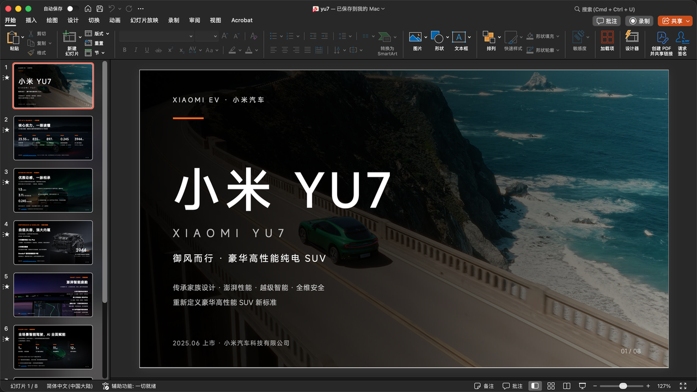
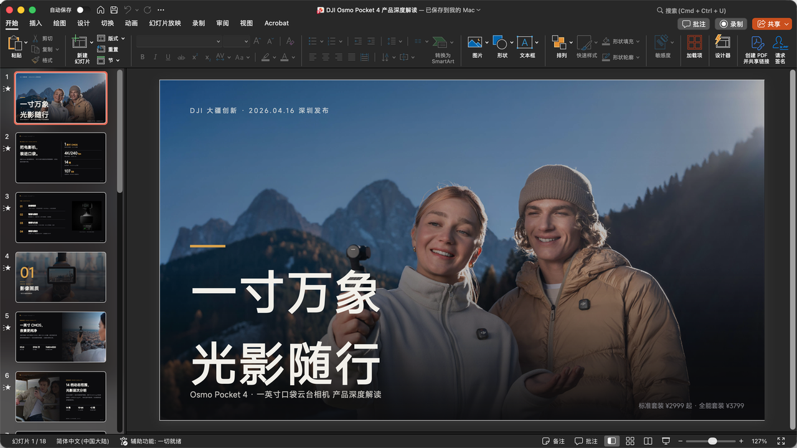
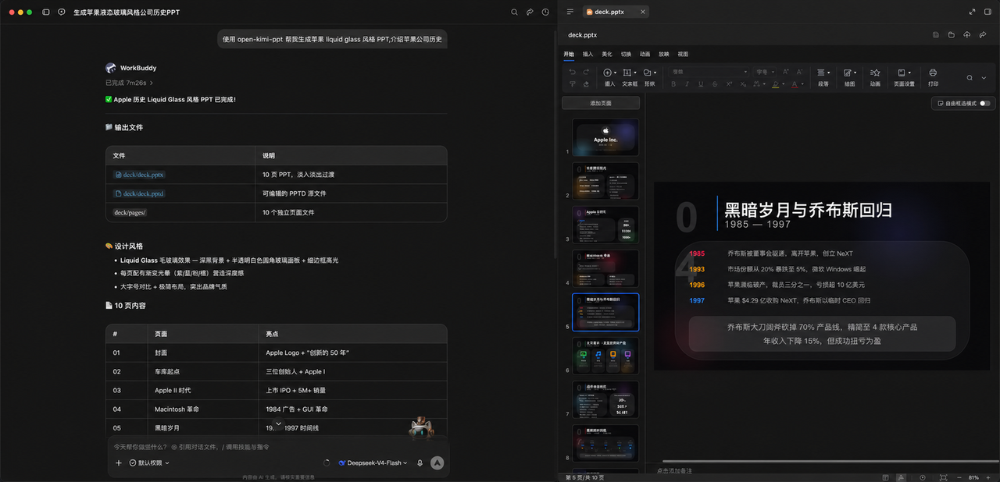
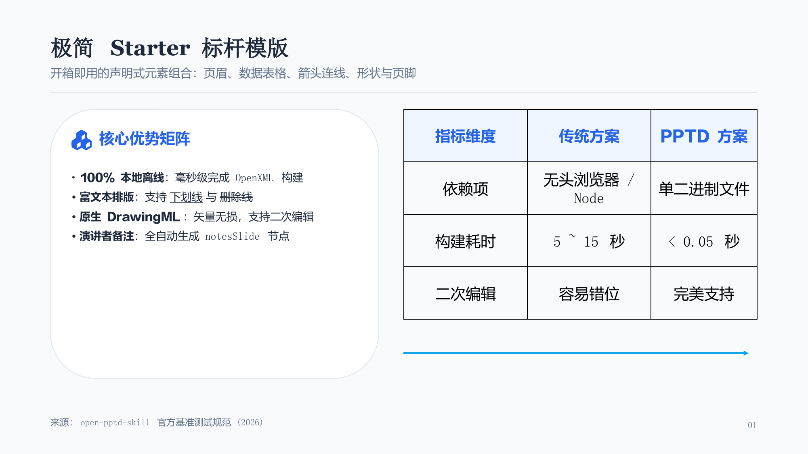

# Open PPTD (`open-pptd`)

[简体中文](README.md) | [English](README_EN.md)

[](https://github.com/shiquda/open-pptd-skill/releases)
[](LICENSE)
[](https://github.com/shiquda/open-pptd-skill/actions/workflows/ci.yml)
[](https://nodejs.org)
[](https://www.rust-lang.org)

**Open PPTD** is an open-source declarative presentation toolkit and AI Agent skill tailored for AI coding agents (Claude Code, Cursor, Codex, WorkBuddy, Multica) and developers. Built on the open **PPTD** (Declarative Presentation Language) YAML specification, it provides a **100% offline, sub-second native Rust compiler (`pptd` CLI)** and an out-of-the-box agent skill.

It completely eliminates brittle dependencies on web sessions, headless browsers, cookies, or cloud API tokens, delivering fully editable, vector-sharp native PowerPoint (`.pptx`) decks and round-trippable project directories directly on your local machine.

---

## 🖼️ Showcase

Open PPTD adheres to a dual-deliverable model: **editable PPTD source code + production-ready native PPTX**. From enterprise keynotes to academic defense slides, it consistently produces professional typography:

| Xiaomi YU7 Keynote Deck (Rich Editorial Layout) | DJI Pocket 4 Product Deck (Panoramic Visuals) |
| :---: | :---: |
| [](docs/images/example-yu7-pptx.png) | [](docs/images/example-dji-pocket4-pptx.png) |

| DeepSeek Liquid Glass Presentation | Minimal Starter Benchmark (Tables / Lines / Notes) |
| :---: | :---: |
| [](docs/images/example-deepseek-liquid-glass.png) | [](example/starter/starter_expected.png) |

---

## 💡 Why Open PPTD?

Common AI presentation generators suffer from major tradeoffs: programmatic OOXML builders easily misalign layouts, whole-page raster image generators cannot be edited in PowerPoint, and web HTML slides are not standard enterprise/academic PPTX files.

| Metric | **Open PPTD** | Programmatic OOXML (e.g. pptxgenjs) | Whole-Page Image PPT | Web HTML Slides |
|---|---|---|---|---|
| **Default Deliverables** | **PPTD Project + Native PPTX** | Usually PPTX only | Single raster image in PPTX | Single HTML file |
| **Agent Authoring** | **Declarative YAML**, clean AST | Verbose coordinates & brittle APIs | Prompt-dependent, unpredictable | Complex HTML/CSS constraints |
| **PowerPoint Editing** | **100% Vector Lossless**, editable text & shapes | Editable, but brittle layout | Bitmap image; text cannot be edited | Not a native PPTX file |
| **Build Speed & Deps** | **<0.05s** (Native Rust, 100% offline) | 1 ~ 5s (Node.js runtime) | 10 ~ 30s (Model queue) | Requires browser runtime |
| **Math Typography** | **Academic LaTeX math rendering** (slanted vars, scripts) | Unsupported or requires plugins | Relies on raster text | MathJax / KaTeX rendering |
| **Security & Privacy** | **Zero network calls**, sandbox-safe | Local runtime | Sends slide content to cloud LLM | Usually requires web renderer |

---

## ⚡ Quick Start

### 1. Install the Native Compiler CLI (`pptd`)

Supported platforms: macOS (Apple Silicon / Intel), Linux (x86_64 / arm64), and Windows (x86_64).

```bash
# Method A: Automatic download script to ~/.local/bin/pptd (Recommended)
curl -fsSL https://raw.githubusercontent.com/shiquda/open-pptd/main/skills/open-pptd/scripts/install_binary.sh | bash

# Method B: Cross-platform Python installer
python3 skills/open-pptd/scripts/install_binary.py

# Method C: Install from source using Cargo
cargo install --git https://github.com/shiquda/open-pptd.git
```

Verify your installation:
```bash
pptd --version
# Output: pptd 1.0.4
```

### 2. Register the Agent Skill (Optional)

Install the skill into your AI coding assistant environment (Codex, Claude Code, Cursor, etc.):

```bash
# Install to default global skills directory ~/.agents/skills/open-pptd
npx github:shiquda/open-pptd install -y

# Or specify a custom target path
npx github:shiquda/open-pptd install --target ~/.claude/skills
```

---

## 🚀 Core Workflows & CLI Commands

### 1. Static Project Diagnostics (`pptd check`)
Perform strict pre-compilation audits for syntax errors, undeclared fields, missing `$theme` color tokens, broken asset paths, and text overflow risks:
```bash
pptd check my_project/deck.pptd
```

### 2. High-Speed Native Compilation (`pptd build`)
Compile the declarative project into an OpenXML `.pptx` presentation with full vector shapes and speaker notes:
```bash
pptd build my_project/deck.pptd -o presentation.pptx
```

### 3. Decompile Existing PPTX to PPTD (`pptd convert`)
Reverse-engineer an existing PowerPoint deck into an editable PPTD project directory (pages, master layouts, tables, and colors):
```bash
pptd convert presentation.pptx ./decompiled_project/
```

### 4. Automated QA Verification (`validate_pptx.py`)
Inspect the generated PPTX package for page counts, leaked unparsed HTML tags, boundary errors, and speaker note coverage:
```bash
python3 skills/open-pptd/scripts/validate_pptx.py presentation.pptx --expected-pages 8 --check-notes
```

---

## 📋 Features

- 📐 **DrawingML Vector Geometries**: Native support for `rect`, `roundRect`, `ellipse`, `triangle`, and `diamond` with stroke, fill, and drop shadows.
- 🔗 **Connector & Arrow Lines**: Relative vector coordinates `points: "0,0 dx,dy"` with start/end arrowheads (`triangle`, `stealth`, etc.).
- 🔢 **Academic LaTeX Math Rendering**: In-line math equations like `\( h(s_t) \ge 0 \)` automatically tokenize into italicized Latin variables, scaled super/subscripts, and proper operators.
- 📊 **Native Bi-directional Tables**: Full support for cell merging (`rowSpan`/`colSpan`), column width ratios, zebra striping, and round-tripping.
- 🗣️ **PowerPoint Speaker Notes**: Page-level `notes: "..."` attributes seamlessly generate standard OOXML `notesSlide` relationships.
- 🎨 **1422 Built-in Vector Icons**: Font Awesome 6.7.2 Solid vector dataset with automatic `fa-` prefix normalization and validation.
- 🔒 **`.sync.hash` Overwrite Protection**: The compiler tracks content hashes to prevent accidental overwrites between manual edits and automated builds.
- 🔤 **Cross-Platform Safe Fonts**: Intelligent Chinese and Latin font mapping prevents cursive/casual script fallbacks on Linux and Windows.

---

## 📁 PPTD Directory Structure

A canonical, self-contained PPTD project directory looks like this:

```text
my_presentation/
├── deck.pptd             # Manifest: slide size, theme tokens, typography, page list
├── pages/
│   ├── 01_cover.page     # Single slide AST (shapes, text, tables, connectors)
│   ├── 02_problem.page
│   └── 03_solution.page
└── assets/               # Local images and media assets
```

For detailed specifications and guides, see:
- [Agent Quickstart Guide (SKILL.md)](skills/open-pptd/SKILL.md)
- [PPTD v2 Specification (pptd.md)](skills/open-pptd/reference/pptd.md)
- [Pre-designed Theme Palettes (theme.md)](theme.md)
- [CLI Reference Manual (cli.md)](skills/open-pptd/reference/cli.md)
- [Typography & Font Guidelines (fonts.md)](skills/open-pptd/reference/fonts.md)

---

## 📄 License & Attribution

This project is licensed under the [MIT License](LICENSE).

### Acknowledgements & Upstream Projects:
1. **`open-kimi-ppt-skill`**:
   Evolved and refactored from `open-kimi-ppt-skill` by **Binaryify Zhuang** (MIT License, [GitHub](https://github.com/acnlie/open-kimi-ppt-skill)). We gratefully acknowledge Binaryify's foundational contribution to the PPTD declarative DSL and AI agent presentation skills.
2. **`slideforge` (Native Rust Compiler Engine)**:
   The underlying native Rust compiler engine was originally created by **meatRoll** ([`meatRoll/slideforge`](https://github.com/meatRoll/slideforge), MIT License). Further secondary development by shiquda and contributors added rich text formatting, LaTeX math typography, PowerPoint speaker notes (`notesSlide`), expanded Font Awesome icon datasets, and strict semantic validation, before being unified into Open PPTD under the `pptd` CLI. We gratefully acknowledge meatRoll's original engineering.
3. **Font Awesome Free 6 (Solid Icons)**:
   Vector icons embedded in the compiler are sourced from Font Awesome 6.7.2 under the CC BY 4.0 license ([License](https://fontawesome.com/license/free)).
